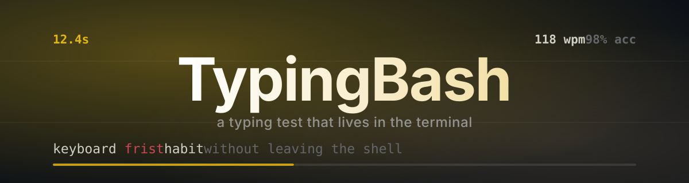

<p align="center">
  
</p>

<p align="center">
  
  
  
  
  
</p>

A typing test for the terminal, in the spirit of [Monkeytype](https://monkeytype.com) but written from scratch to live inside a TUI: raw keyboard capture, flicker-free redrawing and stats you can actually defend.

Nothing to `pip install`. The whole thing — raw mode, double-buffered rendering, UTF-8 key decoding, the word picker — is the Python standard library.

> [!NOTE]
> The **interface text is in Spanish** (it started as a Spanish typing trainer), while the word lists ship in both Spanish and English. Adding a language is a matter of dropping a text file into `data/`.

## Index

- [Why](#why)
- [Installation](#installation)
- [Usage](#usage)
- [How to play](#how-to-play)
- [Commands](#commands)
- [Keys](#keys)
- [Words](#words)
- [Settings](#settings)
- [How the stats are computed](#how-the-stats-are-computed)
- [Under the hood](#under-the-hood)
- [Tests](#tests)
- [Troubleshooting](#troubleshooting)
- [Roadmap](#roadmap)
- [License](#license)

## Why

Every good typing trainer lives in a browser tab, which is exactly the place you were trying to escape. TypingBash is the other bet: the same immediacy — type and the characters light up, no Enter, no round trips — but inside the window you already have open, offline, with no account and no telemetry.

- Runs entirely from the keyboard, in any terminal.
- **Zero dependencies**, zero network, zero files outside `~/.config/typingbash/`.
- Accents and `ñ` are treated as real characters: `año` ≠ `ano`, `rápido` ≠ `rapido`.

<details>
<summary><b>Text rendition of the interface</b></summary>
<br>

```text
████████╗██╗   ██╗██████╗ ██╗███╗   ██╗ ██████╗
╚══██╔══╝╚██╗ ██╔╝██╔══██╗██║████╗  ██║██╔════╝
   ██║    ╚████╔╝ ██████╔╝██║██╔██╗ ██║██║  ███╗
   ██║     ╚██╔╝  ██╔═══╝ ██║██║╚██╗██║██║   ██║
   ██║      ██║   ██║     ██║██║ ╚████║╚██████╔╝
   ╚═╝      ╚═╝   ╚═╝     ╚═╝╚═╝  ╚═══╝ ╚═════╝

              typingbash · test de mecanografía en la terminal
```

And a test in progress:

```text
   12.4s                                            78 wpm   97% acc

   camino ventana rápido mañana silencio trabajo ciudad noche agua
   montaña recuerdo pequeño escribir tiempo persona mundo coche
   historia lunes cocina ordenador pantalla llave viaje sombra

   ████████████████████░░░░░░░░░░░░░░░░░░░░░░░░░░░░░░░░░░░░░░░░

                tab reiniciar   esc menú   / comandos
```

Typed characters turn bright, wrong ones go red, the untyped rest stays dim — in the real thing all of that is in color, and the counter is drawn in block digits when the window is tall enough.

</details>

## Installation

| Requirement | Notes |
|---|---|
| `python3` (3.10+) | macOS ships with Python 3; `brew install python` otherwise |
| A terminal of at least **60x18** | the game tells you if the window is too small |
| Nothing else | no libraries, no build step |

```sh
git clone https://github.com/alexcalatyd/TypingBash.git
cd TypingBash
./typingbash
```

That's the whole install. To have it available from anywhere:

```sh
ln -s "$PWD/typingbash" /opt/homebrew/bin/typingbash
```

<details>
<summary><b>Or install it with pip</b></summary>
<br>

```sh
python3 -m venv .venv
source .venv/bin/activate
pip install -e .
```

> [!TIP]
> `pip install` **outside** a virtualenv fails on Homebrew Pythons — since PEP 668 they're marked as "externally managed". The symlink above is the simpler route; `pipx install -e .` also works.

The install is editable (`-e`) on purpose, so the dictionaries in `data/` keep being read from the repository instead of being copied around.

</details>

> [!NOTE]
> Developed and tested on **macOS**. It uses plain POSIX APIs (`termios`, `tty`, `select`) and works on Linux too; only the optional sound effects are macOS-specific, since they go through `afplay`.

## Usage

```sh
typingbash                   # main menu
python3 main.py              # same thing, if you prefer it that way
python3 -m typingbash        # as a module (needs PYTHONPATH=src)
```

<details>
<summary><b>All the options</b></summary>
<br>

| Option | What it does |
|---|---|
| `--time SECONDS` | time mode, with that duration (5–600) |
| `--words COUNT` | word mode, with that many words (5–500) |
| `--difficulty easy\|normal\|hard` | vocabulary length and rarity |
| `--language es\|en` | which word list to use |
| `--theme ...` | `minimal`, `nord`, `dracula`, `matrix` or `solar` |
| `--size large\|medium\|small` | how much of the terminal the UI fills |
| `--no-animations` | no logo reveal, no countdown |
| `--start` | skip the menu and start a test right away |
| `--list` | print the available languages and themes |
| `--version` | print the version |

```sh
typingbash --time 60 --start       # a 60-second test, straight in
typingbash --words 50 --start      # 50 words
typingbash --language en --theme nord
```

</details>

## How to play

1. Run `typingbash`.
2. Press **enter**. After a short countdown the text appears.
3. Start typing — **the clock doesn't start until your first keystroke**.
4. Space commits the word and moves on. Backspace walks back into a word you got wrong.
5. Results come up at the end: **enter** goes again, **esc** returns to the menu.

From the menu, **m** switches mode and **1**–**4** pick a preset, so you never have to touch a command.

There are two modes. **Time** keeps refilling words as you go, so you can't run out of text; **words** ends when you finish the count. Records are stored **per modality** (`30s`, `50 words`…), because comparing a 15-second test against a two-minute one tells you nothing.

## Commands

Press **/** on any screen to open the command line (during a running test `/` is just a character, so it never interrupts you). Commands take aliases and complete with tab.

| Command | Aliases | What it does |
|---|---|---|
| `/time <seconds>` | `/t` | time mode (5–600) |
| `/words <count>` | `/w` | word mode (5–500) |
| `/difficulty <level>` | `/diff`, `/d` | `easy`, `normal` or `hard` |
| `/language <code>` | `/lang`, `/l` | `es` or `en` |
| `/theme <name>` | | `minimal`, `nord`, `dracula`, `matrix`, `solar` |
| `/size <size>` | `/ui` | `large`, `medium` or `small` |
| `/set <setting> <value>` | | change any setting |
| `/settings` | `/config` | the settings screen |
| `/stats` | | session and all-time stats |
| `/history` | `/hist` | past results |
| `/restart` | `/r` | restart the test |
| `/menu` | | back to the menu |
| `/help` | `/h`, `/?` | full help |
| `/quit` | `/q`, `/exit` | quit |

Everything is validated: `/time abc`, `/words -50` and `/banana` answer with a clear message instead of breaking.

## Keys

<table>
<tr>
<td valign="top" width="50%">

**Typing**

| Key | Action |
|---|---|
| `enter` | start, or go again |
| `tab` | restart with fresh words |
| `esc` | back to the menu, or close the screen |
| `backspace` | delete a character |
| `ctrl`/`alt` + `backspace` | delete the whole word |
| `/` | command line |
| `ctrl+c` | quit, leaving the terminal as it was |

</td>
<td valign="top" width="50%">

**Menu and screens**

| Key | Action |
|---|---|
| `m` | switch mode (time / words) |
| `1`–`4` | presets for the current mode |
| `s` | settings |
| `h` | history |
| `e` | stats |
| `↑` `↓` `←` `→` | move through lists and settings |

</td>
</tr>
</table>

## Words

The Spanish dictionary is **1,289 words written by hand** for this project — real everyday vocabulary, never generated and never concatenated from stems. English ships too, mostly to prove that a new language is one file plus one entry in `data/languages.json`.

Picking words is not a `random.choice` loop:

- recent words don't repeat;
- lexical families don't land back to back (no `casa casas casita`);
- lengths are balanced, so a test doesn't turn into a wall of eight-letter words.

Difficulty moves both axes: `easy` stays short and frequent, `hard` pulls from the extended list with longer and rarer words.

## Settings

Settings save themselves the moment you change one:

```text
~/.config/typingbash/config.json     preferences
~/.config/typingbash/history.json    past results and records
```

Both are plain JSON and safe to edit by hand: an invalid value gets corrected at startup instead of crashing. Delete them to start over (`rm -rf ~/.config/typingbash`).

Available settings: `mode`, `time_seconds`, `word_count`, `language`, `difficulty`, `theme`, `ui_size`, `big_counter`, `live_wpm`, `live_accuracy`, `animations`, `countdown`, `sound`, `stop_on_error`.

<details>
<summary><b>Interface size</b></summary>
<br>

`ui_size` decides how much of the terminal the game takes. Change it from **s** (settings) or with `/size`:

| Value | How it looks |
|---|---|
| `large` (default) | fills the window within its margins: text edge to edge, more lines in view, double-height counter, wide panels |
| `medium` | halfway between the classic measurements and full screen |
| `small` | the classic measurements: text capped at 120 columns, compact panels |

The test screen also adapts to the window: 3 to 8 lines of text depending on height, and from 26 rows up it draws the counter in block digits. `/set big_counter off` keeps it small.

</details>

<details>
<summary><b>Sound</b></summary>
<br>

Optional keystroke and error sounds, played through macOS's `afplay` with system sounds. **Off by default** — turn them on with `/set sound on`.

</details>

## How the stats are computed

| Metric | Formula |
|---|---|
| **wpm** | `correct_chars / 5 / minutes` — a "word" is 5 characters |
| **raw wpm** | `typed_chars / 5 / minutes`, errors included |
| **accuracy** | `correct_keystrokes / total_keystrokes` |
| **consistency** | `100 · (1 − σ/μ)` over the raw wpm of each second |
| **score** | `correct_chars · accuracy² · (1 + wpm/100)` |

Two decisions worth knowing about:

- **Deleting doesn't clear your record.** Accuracy counts keystrokes, so a mistake you fixed with backspace still counts. The text ends up perfect; the accuracy doesn't.
- **What the clock cuts off isn't punished.** If time runs out mid-word, the letters you never got to type don't count as missed.

## Under the hood

<details>
<summary><b>How it works</b></summary>
<br>

- **Input**: the TTY goes into raw mode (`termios`), so every keystroke arrives without waiting for Enter, and it's restored on exit, on a signal, and even on an unexpected crash. The decoder handles escape sequences, UTF-8 split across reads, and dead keys that arrive uncomposed (`´` + `a` → `á`).
- **Rendering**: a double buffer diffs the previous frame against the new one and emits only the cells that changed, so there's no flicker and no full repaints. Nothing paints the background, so the game respects whatever your terminal uses.
- **Color**: palettes are defined once in RGB and translated to the best format the terminal supports — 24-bit when `COLORTERM` says so, the 256-color palette otherwise.
- **Timing**: the clock starts on the first keystroke, not when the screen appears, and raw wpm is sampled every second to build the pace graph and the consistency figure.

</details>

<details>
<summary><b>Project layout</b></summary>
<br>

```text
typingbash            launcher
main.py               alias of the launcher
data/
  languages.json      language registry
  es/{common,extended}.txt
  en/common.txt
src/typingbash/
  app.py              main loop and navigation
  engine.py           test logic (no interface)
  stats.py            the metric formulas
  words.py            dictionaries and word picking
  config.py           settings, validation and persistence
  history.py          past results and records
  commands.py         command registry
  prompt.py           the command line
  terminal.py         raw mode and TTY restoration
  keys.py             keystroke decoding
  render.py           double buffer and differential repaint
  theme.py            color palettes
  ui.py               frames, bars and formatting
  sound.py            optional effects
  screens/            menu, test, results, settings, history, stats, help
tests/
```

The separation is strict where it matters: `engine.py`, `stats.py`, `words.py`, `config.py`, `history.py` and `commands.py` have no idea a terminal exists. That's what makes them testable for real.

</details>

## Tests

```sh
PYTHONPATH=src:tests python3 -m unittest discover -s tests
```

179 tests, no test runner to install. They cover the wpm and accuracy formulas, error counting, finishing by time and by word count, word picking, command validation, persistence, the layout at different terminal sizes, and keyboard decoding — including UTF-8 cut in half and escape sequences. `pytest` works too, if you'd rather: `pip3 install pytest && pytest`.

## Troubleshooting

<details>
<summary><b>"ventana demasiado pequeña"</b></summary>
<br>

The window is below 60x18. The message shows the current size; make the terminal bigger.

</details>

<details>
<summary><b>Accented characters don't come out</b></summary>
<br>

Check that your terminal is on UTF-8 (`locale` should show `UTF-8`). The game forces UTF-8 on output, but the keyboard side depends on the system.

</details>

<details>
<summary><b>The colors look flat or wrong</b></summary>
<br>

Terminal.app doesn't do 24-bit color; the game reads `COLORTERM` and falls back to 256 colors on its own. iTerm2, Ghostty and WezTerm show the full palette.

</details>

<details>
<summary><b>"Este juego necesita una terminal interactiva"</b></summary>
<br>

It was launched through a pipe or a redirection. Run it directly in a terminal window.

</details>

<details>
<summary><b>The terminal is left in a weird state</b></summary>
<br>

It shouldn't happen — the TTY is restored on exit, on signals and on unexpected errors. If it ever does, `reset` fixes it.

</details>

## Roadmap

- [x] Real-time typing, character by character
- [x] Time and word modes, with refilling text
- [x] Hand-written Spanish dictionary, with lexical-family and length balancing
- [x] Exact accents, `ñ` and dead keys
- [x] Honest stats: wpm, raw, accuracy, consistency, score
- [x] History and per-modality personal records
- [x] Monkeytype-style command line with completion
- [x] Five themes, animated countdown and pace graph
- [ ] English interface, alongside the English word list
- [ ] Punctuation and numbers mode
- [ ] Per-key accuracy heatmap
- [ ] Quote mode (type real sentences, not word soup)

## License

MIT — see [LICENSE](LICENSE).

<p align="center"><sub>Fewer tabs. More terminal.</sub></p>
